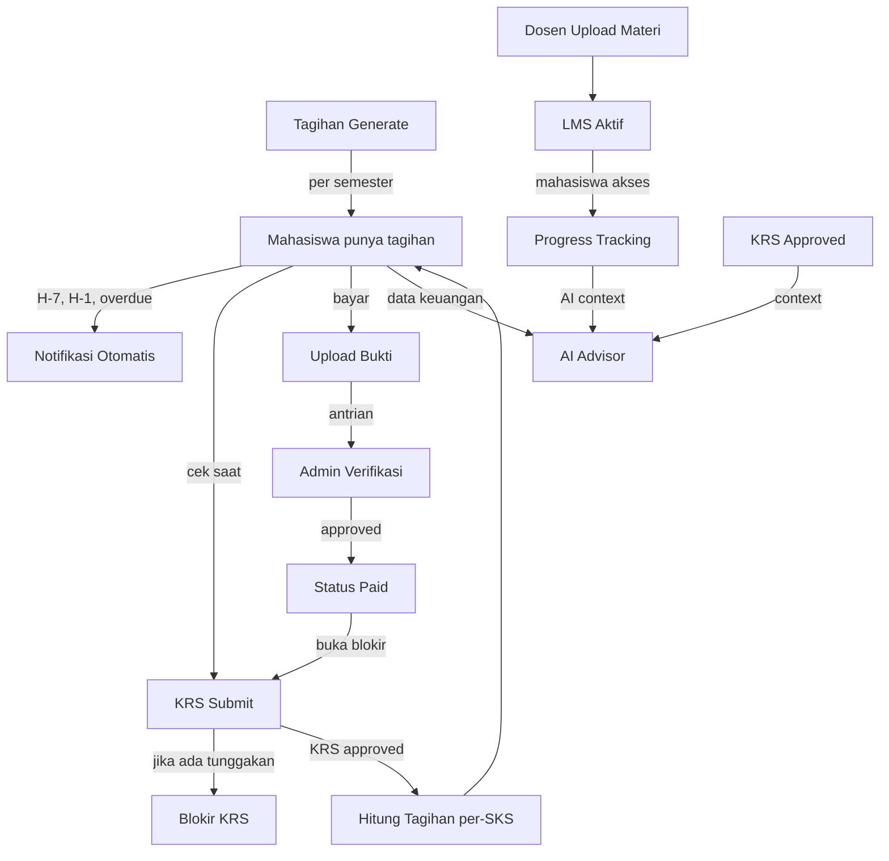

# 📋 Product Requirements Document (PRD)
## SIAKAD v2 — Sistem Informasi Akademik + LMS + Keuangan

| Atribut | Detail |
|---------|--------|
| **Versi Dokumen** | 1.0.0 |
| **Status** | Draft |
| **Tanggal** | 30 September 2026 |
| **Platform Existing** | Laravel 12 + PHP 8.2 + TailwindCSS 3 + Alpine.js 3 |
| **Dibuat untuk** | Tim Pengembang SIAKAD |

---

## 1. Latar Belakang & Tujuan

### 1.1 Problem Statement

SIAKAD v1 (existing) telah menangani kebutuhan akademik dasar — KRS, nilai, presensi, skripsi, dan KP. Namun, institusi pendidikan modern membutuhkan dua pilar tambahan yang terintegrasi erat dengan data akademik:

1. **LMS (Learning Management System)** yang lebih komprehensif — saat ini hanya ada modul materi & tugas dasar, belum mencakup kuis interaktif, video pembelajaran, forum diskusi, dan progress tracking yang terstruktur.
2. **Sistem Keuangan** — saat ini tidak ada modul keuangan sama sekali. Pembayaran SPP, biaya wisuda, denda, beasiswa, dan laporan keuangan dikelola secara manual/terpisah, menyebabkan inefisiensi dan potensi kehilangan data.

### 1.2 Goals & Objectives

| # | Objective | Key Result |
|---|-----------|------------|
| G1 | Integrasikan LMS lengkap ke dalam SIAKAD | Mahasiswa & dosen dapat mengelola seluruh pembelajaran dalam satu platform |
| G2 | Bangun Sistem Keuangan terintegrasi | Tagihan SPP otomatis terhubung dengan status akademik (KRS tidak bisa submit jika ada tunggakan) |
| G3 | Tingkatkan AI Advisor | AI memahami konteks keuangan + akademik mahasiswa secara holistik |
| G4 | Sediakan laporan terpadu | Admin/Pimpinan bisa melihat dashboard akademik + keuangan dalam satu tampilan |

### 1.3 Non-Goals (Out of Scope v2)

- ❌ Mobile native app (iOS/Android) — cukup responsive web
- ❌ Integrasi dengan sistem perbankan secara langsung (hanya upload bukti bayar)
- ❌ Sistem HR/penggajian dosen
- ❌ e-Commerce untuk penjualan produk kampus

---

## 2. User Personas

### 👨‍🎓 Persona 1: Budi — Mahasiswa Semester 5
- **Goals**: Akses materi kuliah kapan saja, bayar SPP online, tahu status keuangan sebelum isi KRS
- **Pain Points**: Harus ke TU untuk cek tagihan, materi kuliah tersebar di WhatsApp/Google Drive, tidak tahu apakah SKS-nya cukup
- **Tech Savvy**: Menengah — familiar dengan aplikasi mobile dan web

### 👩‍🏫 Persona 2: Dr. Siti — Dosen Pengampu
- **Goals**: Upload materi sekali, buat kuis otomatis, pantau progress belajar mahasiswa
- **Pain Points**: Koreksi tugas manual memakan waktu, sulit tracking siapa yang belum kumpul
- **Tech Savvy**: Menengah — bisa pakai Google Classroom, familiar dengan upload file

### 🔧 Persona 3: Rina — Admin Akademik & Keuangan
- **Goals**: Generate tagihan SPP otomatis tiap semester, kelola beasiswa, lihat laporan bulanan
- **Pain Points**: Rekonsiliasi pembayaran manual, mahasiswa sering lupa bayar sehingga perlu diingatkan manual
- **Tech Savvy**: Menengah-tinggi — terbiasa dengan spreadsheet dan sistem ERP sederhana

### 👔 Persona 4: Rektor/Dekan — Pimpinan Institusi
- **Goals**: Dashboard eksekutif — berapa mahasiswa aktif, total penerimaan SPP, angka kelulusan, efektivitas LMS
- **Pain Points**: Laporan harus minta ke beberapa bagian, data tidak real-time
- **Tech Savvy**: Rendah-menengah — hanya butuh dashboard yang mudah dibaca

---

## 3. Scope Modul

```
SIAKAD v2
├── [EXISTING] Modul Akademik (di-enhance)
│   ├── KRS, KHS, Transkrip, Presensi
│   ├── Jadwal Kuliah
│   ├── Skripsi & KP
│   └── [NEW] Integrasi cek tunggakan sebelum submit KRS
│
├── [ENHANCED] Modul LMS
│   ├── [EXISTING] Materi & Tugas
│   ├── [NEW] Kuis & Bank Soal
│   ├── [NEW] Forum Diskusi per Kelas
│   ├── [NEW] Video Pembelajaran (embed/upload)
│   ├── [NEW] Progress Tracking per Mahasiswa
│   ├── [NEW] Sertifikat Penyelesaian
│   └── [NEW] Penilaian Otomatis (Kuis)
│
├── [NEW] Modul Keuangan
│   ├── Master Tarif (SPP, SKS, Wisuda, dll)
│   ├── Tagihan Mahasiswa
│   ├── Pembayaran & Verifikasi
│   ├── Beasiswa & Keringanan
│   ├── Laporan Keuangan
│   └── Notifikasi Tagihan Otomatis
│
└── [ENHANCED] AI Academic Advisor
    └── Konteks keuangan + akademik terintegrasi
```

---

## 4. Functional Requirements

### 4.1 Modul Akademik (Enhancement)

#### FR-AKD-01: Blokir KRS saat Tunggakan
- **Deskripsi**: Sebelum mahasiswa bisa submit KRS, sistem wajib mengecek apakah mahasiswa memiliki tagihan yang belum lunas.
- **Aturan Bisnis**:
  - Jika ada tagihan **jatuh tempo** yang belum dibayar → KRS diblokir dengan pesan informatif
  - Jika ada tagihan **belum jatuh tempo** → KRS boleh diisi tapi ada banner peringatan
  - Admin/Keuangan dapat memberikan dispensasi manual (override blokir)
- **Priority**: 🔴 High

#### FR-AKD-02: Status Mahasiswa Aktif/Non-Aktif
- **Deskripsi**: Status akademik mahasiswa otomatis berubah berdasarkan pembayaran.
- **Aturan Bisnis**:
  - Belum bayar SPP di akhir periode grace period (14 hari setelah jatuh tempo) → status `non-aktif`
  - Status `non-aktif` mencegah akses LMS, cetak transkrip, dan pengajuan skripsi/KP
- **Priority**: 🔴 High

---

### 4.2 Modul LMS (Enhanced)

#### FR-LMS-01: Manajemen Materi (Enhancement dari existing)
| Sub-Fitur | Deskripsi | Priority |
|-----------|-----------|----------|
| Upload file multi-format | PDF, DOCX, PPT, ZIP, gambar | 🔴 High |
| Embed video | YouTube URL atau upload MP4 langsung | 🟡 Medium |
| Urutan materi | Dosen bisa atur urutan tampil | 🟡 Medium |
| Visible date | Materi hanya tampil ab tanggal tertentu | 🟡 Medium |
| Download tracking | Log siapa yang sudah download materi | 🟢 Low |

#### FR-LMS-02: Tugas (Enhancement dari existing)
| Sub-Fitur | Deskripsi | Priority |
|-----------|-----------|----------|
| Tipe tugas | File upload, teks, link URL | 🔴 High |
| Deadline dengan jam | Bukan hanya tanggal, tapi jam pula | 🔴 High |
| Late submission | Dosen bisa set: izinkan/tolak terlambat | 🟡 Medium |
| Grading rubrik | Dosen isi rubrik penilaian | 🟡 Medium |
| Feedback per submission | Komentar teks + nilai per mahasiswa | 🔴 High |
| Bulk download | Download semua submission sekaligus | 🟡 Medium |
| Plagiarisme flag | Deteksi similarity antar submission (basic) | 🟢 Low |

#### FR-LMS-03: Kuis & Bank Soal (NEW)
| Sub-Fitur | Deskripsi | Priority |
|-----------|-----------|----------|
| Tipe soal | Pilihan ganda (single/multiple), true/false, isian singkat | 🔴 High |
| Bank soal per MK | Dosen bisa simpan soal untuk digunakan ulang | 🟡 Medium |
| Randomisasi soal | Urutan soal/pilihan diacak per mahasiswa | 🟡 Medium |
| Batas waktu | Timer kuis (menit) | 🔴 High |
| Nilai otomatis | Pilihan ganda & true/false dikoreksi otomatis | 🔴 High |
| Review jawaban | Mahasiswa bisa lihat jawaban benar setelah kuis | 🟡 Medium |
| Batas percobaan | Jumlah max kali ujian | 🟡 Medium |
| Mode keamanan | Satu tab, tidak bisa copy-paste (best effort) | 🟢 Low |
| Statistik kuis | Distribusi nilai, soal paling banyak salah | 🟢 Low |

#### FR-LMS-04: Forum Diskusi per Kelas (NEW)
| Sub-Fitur | Deskripsi | Priority |
|-----------|-----------|----------|
| Thread & reply | Mahasiswa/Dosen bisa buat topik, reply bertingkat | 🔴 High |
| Attach file | Upload file di diskusi | 🟡 Medium |
| Like/upvote reply | Tandai jawaban terbaik | 🟡 Medium |
| Notifikasi | Notif ketika ada reply di thread yang diikuti | 🔴 High |
| Moderasi dosen | Dosen bisa hapus/pin thread | 🟡 Medium |
| Tandai terjawab | Mark sebagai terjawab | 🟡 Medium |

#### FR-LMS-05: Progress Tracking (NEW)
| Sub-Fitur | Deskripsi | Priority |
|-----------|-----------|----------|
| Progress bar per kelas | Persentase materi yang sudah dibuka | 🔴 High |
| Completion status | Centang otomatis ketika materi dibuka | 🔴 High |
| Report per mahasiswa | Dosen lihat progress detail tiap mahasiswa | 🔴 High |
| Activity heatmap | Kapan mahasiswa paling aktif belajar | 🟢 Low |
| Nilai rekap | Rekap nilai tugas + kuis per kelas | 🔴 High |

#### FR-LMS-06: Sertifikat Penyelesaian (NEW)
- Otomatis ter-generate ketika mahasiswa menyelesaikan semua modul + nilai ≥ passing grade
- PDF dengan QR code verifikasi
- **Priority**: 🟢 Low

---

### 4.3 Modul Keuangan (NEW)

#### FR-KEU-01: Master Tarif
| Sub-Fitur | Deskripsi | Priority |
|-----------|-----------|----------|
| Jenis tagihan | SPP Pokok, Biaya per-SKS, Dana Pengembangan, Wisuda, Praktikum, KP, dll | 🔴 High |
| Tarif per prodi | Tiap prodi bisa punya tarif berbeda | 🔴 High |
| Tarif per angkatan | Angkatan berbeda bisa punya tarif berbeda | 🟡 Medium |
| Periode tarif | Tarif berlaku dari-sampai tanggal | 🔴 High |

#### FR-KEU-02: Generate Tagihan Otomatis
| Sub-Fitur | Deskripsi | Priority |
|-----------|-----------|----------|
| Generate per semester | Admin klik "Generate Tagihan" → sistem buat tagihan untuk semua mahasiswa aktif | 🔴 High |
| Kalkulasi SKS | Tagihan per-SKS otomatis dihitung dari KRS yang sudah disetujui | 🔴 High |
| Tagihan individual | Admin bisa tambah tagihan manual (misal: denda buku perpustakaan) | 🟡 Medium |
| Jatuh tempo | Set tanggal jatuh tempo per tagihan | 🔴 High |
| Status tagihan | `unpaid` → `partial` → `paid` → `overdue` | 🔴 High |

#### FR-KEU-03: Pembayaran Mahasiswa
| Sub-Fitur | Deskripsi | Priority |
|-----------|-----------|----------|
| Lihat tagihan | Mahasiswa lihat daftar tagihan beserta status | 🔴 High |
| Upload bukti bayar | Upload foto/PDF bukti transfer | 🔴 High |
| Riwayat pembayaran | Histori semua transaksi | 🔴 High |
| Cetak kwitansi | PDF kwitansi setelah diverifikasi | 🟡 Medium |
| Virtual account info | Tampilkan nomor VA dan instruksi bayar (integrasi manual/gateway opsional) | 🟡 Medium |

#### FR-KEU-04: Verifikasi Pembayaran (Admin Keuangan)
| Sub-Fitur | Deskripsi | Priority |
|-----------|-----------|----------|
| Antrian verifikasi | Daftar pembayaran yang menunggu konfirmasi | 🔴 High |
| Review bukti | Lihat bukti bayar mahasiswa | 🔴 High |
| Approve/Reject | Verifikasi dengan catatan | 🔴 High |
| Partial payment | Bisa verifikasi pembayaran sebagian | 🟡 Medium |
| Bulk verify | Verifikasi banyak pembayaran sekaligus | 🟡 Medium |
| Log audit | Siapa yang verifikasi, kapan | 🔴 High |

#### FR-KEU-05: Beasiswa & Keringanan
| Sub-Fitur | Deskripsi | Priority |
|-----------|-----------|----------|
| Jenis beasiswa | Beasiswa penuh, parsial (persentase/nominal) | 🔴 High |
| Assign beasiswa ke mahasiswa | Admin assign per mahasiswa per semester | 🔴 High |
| Auto-diskon tagihan | Ketika beasiswa diassign, tagihan otomatis dikurangi | 🔴 High |
| Keringanan custom | Diskon/dispensasi per kasus | 🟡 Medium |
| Laporan penerima beasiswa | Siapa saja yang dapat beasiswa, berapa nilainya | 🟡 Medium |

#### FR-KEU-06: Laporan Keuangan
| Sub-Fitur | Deskripsi | Priority |
|-----------|-----------|----------|
| Rekapitulasi per periode | Total tagihan, terbayar, tunggakan per bulan/semester | 🔴 High |
| Per Prodi/Fakultas | Filter laporan berdasarkan prodi/fakultas | 🔴 High |
| Aging report | Mahasiswa dengan tunggakan terlama | 🟡 Medium |
| Laporan beasiswa | Rekapitulasi beasiswa per semester | 🟡 Medium |
| Export Excel/PDF | Download laporan keuangan | 🔴 High |
| Grafik trend | Tren penerimaan bulanan, chart | 🟡 Medium |

#### FR-KEU-07: Notifikasi Keuangan Otomatis
| Trigger | Notifikasi |
|---------|------------|
| H-7 jatuh tempo | Reminder tagihan akan jatuh tempo |
| H-1 jatuh tempo | Reminder terakhir |
| Melewati jatuh tempo | Notif tagihan overdue |
| Pembayaran diterima | Konfirmasi verifikasi berhasil |
| Pembayaran ditolak | Notif dengan alasan |
| Beasiswa diassign | Notif beasiswa diterima |

- **Notifikasi via**: in-app (existing notification system) + email
- **Priority**: 🔴 High

---

### 4.4 AI Academic Advisor (Enhancement)

#### FR-AI-01: Konteks Keuangan dalam AI Chat
- AI dapat menjawab pertanyaan seperti:
  - "Berapa tagihan SPP saya semester ini?"
  - "Apakah saya bisa isi KRS sekarang?"
  - "Kapan jatuh tempo tagihan saya?"
- Data keuangan dimasukkan ke context prompt AI (hanya read-only, tidak bisa transaksi)
- **Priority**: 🟡 Medium

#### FR-AI-02: Rekomendasi Akademik + Keuangan
- AI dapat merekomendasikan: "Nilai kamu semester lalu rendah, pertimbangkan mengambil lebih sedikit SKS"
- AI mengingatkan: "Kamu belum menyelesaikan materi LMS minggu ini"
- **Priority**: 🟡 Medium

---

## 5. Non-Functional Requirements

### 5.1 Performa
| Metrik | Target |
|--------|--------|
| Page load time | < 2 detik (tanpa file besar) |
| API response | < 500ms untuk query umum |
| Upload file materi | Maks 100MB per file |
| Upload bukti bayar | Maks 5MB per file |
| Concurrent users | 500 user aktif bersamaan |
| Uptime | 99.5% |

### 5.2 Keamanan
| Aspek | Implementasi |
|-------|-------------|
| Autentikasi | Laravel Breeze (existing) + remember token |
| Otorisasi | Spatie RBAC + Policy per modul |
| Rate limiting | Keuangan: 5 req/min; LMS submit: 30 req/min |
| Data keuangan | Encrypt nominal tagihan di DB (jika dibutuhkan) |
| File upload | Validasi MIME type, scan nama file, simpan di private storage |
| Audit trail | Semua aksi keuangan dicatat di `activity_log` |
| HTTPS | Wajib di production |

### 5.3 Skalabilitas
- Database: MySQL dengan index yang sudah ada, tambah index untuk tabel keuangan baru
- Caching: Master tarif, laporan agregat dicache via `CacheService` (extend existing)
- Queue: Generate tagihan massal, kirim email notifikasi via job queue (existing queue worker)

### 5.4 Aksesibilitas & UX
- Responsive untuk mobile (mahasiswa sering akses via HP)
- Bahasa Indonesia penuh
- Error message yang informatif dan actionable

---

## 6. Data Model (Tambahan)

### 6.1 Tabel Keuangan Baru

```sql
-- Jenis tagihan yang bisa dibebankan
jenis_tagihan
  id, nama, kode, keterangan, is_per_sks (bool), is_aktif

-- Tarif berdasarkan prodi dan angkatan
tarif
  id, jenis_tagihan_id, prodi_id, angkatan, nominal, berlaku_dari, berlaku_sampai

-- Header tagihan per mahasiswa per semester
tagihan
  id, mahasiswa_id, tahun_akademik_id, jenis_tagihan_id,
  nominal_tagihan, nominal_diskon, nominal_akhir,
  tanggal_tagihan, tanggal_jatuh_tempo,
  status (unpaid|partial|paid|overdue|waived),
  keterangan, created_by, created_at, updated_at

-- Transaksi pembayaran
pembayaran
  id, tagihan_id, mahasiswa_id, jumlah_bayar,
  tanggal_bayar, metode_bayar, no_referensi,
  bukti_bayar_path, catatan_mahasiswa,
  status (pending|verified|rejected),
  verified_by, verified_at, catatan_verifikasi,
  created_at, updated_at

-- Beasiswa dan keringanan
beasiswa
  id, nama, tipe (penuh|parsial_persen|parsial_nominal),
  nilai (persentase atau nominal), keterangan, is_aktif

-- Penerima beasiswa per semester
beasiswa_mahasiswa
  id, beasiswa_id, mahasiswa_id, tahun_akademik_id,
  nilai_override, catatan, created_by, created_at
```

### 6.2 Tabel LMS Baru

```sql
-- Bank soal per mata kuliah
bank_soal
  id, mata_kuliah_id, dosen_id, pertanyaan, tipe (pg|tf|isian),
  opsi_jawaban (JSON), kunci_jawaban, bobot, created_at

-- Kuis (header)
kuis
  id, kelas_id, judul, instruksi, durasi_menit,
  batas_percobaan, acak_soal (bool), acak_opsi (bool),
  tampil_jawaban (bool), passing_grade, nilai_kontribusi,
  dibuka_pada, ditutup_pada, created_at

-- Soal dalam kuis (pivot)
kuis_soal
  id, kuis_id, bank_soal_id, urutan, bobot_override

-- Sesi pengerjaan kuis mahasiswa
kuis_sesi
  id, kuis_id, mahasiswa_id, percobaan_ke,
  mulai_pada, selesai_pada, nilai, status (ongoing|submitted|timeout)

-- Jawaban mahasiswa per soal
kuis_jawaban
  id, kuis_sesi_id, bank_soal_id, jawaban_mahasiswa,
  is_benar (bool), nilai_didapat

-- Forum diskusi
forum_thread
  id, kelas_id, dosen_id, mahasiswa_id, judul, konten,
  is_pinned (bool), is_closed (bool), created_at

-- Reply forum
forum_reply
  id, thread_id, user_id, parent_id (nullable, untuk nested),
  konten, is_best_answer (bool), created_at

-- Progress tracking materi per mahasiswa
materi_progress
  id, materi_id, mahasiswa_id, dibuka_pada, selesai_pada, durasi_detik
```

---

## 7. Role & Permission Matrix

### 7.1 Modul LMS

| Aksi | Mahasiswa | Dosen | Admin |
|------|:---------:|:-----:|:-----:|
| Lihat materi kelas sendiri | ✅ | ✅ | ✅ |
| Upload/edit/hapus materi | ❌ | ✅ (kelas sendiri) | ✅ |
| Submit tugas | ✅ | ❌ | ❌ |
| Grade tugas | ❌ | ✅ | ❌ |
| Buat/edit kuis | ❌ | ✅ (kelas sendiri) | ✅ |
| Kerjakan kuis | ✅ | ❌ | ❌ |
| Buat thread forum | ✅ | ✅ | ✅ |
| Hapus thread/reply | ❌ | ✅ (kelas sendiri) | ✅ |
| Lihat progress mahasiswa | ❌ | ✅ (kelas sendiri) | ✅ |

### 7.2 Modul Keuangan

| Aksi | Mahasiswa | Dosen | Admin Keuangan | Admin Akademik | Superadmin |
|------|:---------:|:-----:|:--------------:|:--------------:|:----------:|
| Lihat tagihan sendiri | ✅ | ❌ | ✅ | ✅ | ✅ |
| Upload bukti bayar | ✅ | ❌ | ❌ | ❌ | ❌ |
| Verifikasi pembayaran | ❌ | ❌ | ✅ | ❌ | ✅ |
| Generate tagihan | ❌ | ❌ | ✅ | ❌ | ✅ |
| Kelola tarif | ❌ | ❌ | ✅ | ❌ | ✅ |
| Kelola beasiswa | ❌ | ❌ | ✅ | ❌ | ✅ |
| Laporan keuangan | ❌ | ❌ | ✅ | ❌ | ✅ |
| Override blokir KRS | ❌ | ❌ | ✅ | ✅ | ✅ |
| Export laporan | ❌ | ❌ | ✅ | ✅ | ✅ |

> [!NOTE]
> **Role Baru yang Perlu Ditambahkan**: `keuangan` — Admin Keuangan yang hanya memiliki akses ke modul keuangan, tanpa akses ke master data akademik.

---

## 8. User Stories Utama

### Mahasiswa

```
US-M-01: Sebagai mahasiswa, saya ingin melihat total tagihan saya sebelum mengisi KRS,
         sehingga saya bisa mempersiapkan pembayaran tepat waktu.

US-M-02: Sebagai mahasiswa, saya ingin mengupload bukti pembayaran SPP dari rumah,
         sehingga saya tidak perlu antri di TU kampus.

US-M-03: Sebagai mahasiswa, saya ingin mengerjakan kuis online dengan timer,
         sehingga pengujian lebih fair dan terstandarisasi.

US-M-04: Sebagai mahasiswa, saya ingin berdiskusi di forum per kelas,
         sehingga saya bisa tanya jawab tanpa menunggu jam kuliah.

US-M-05: Sebagai mahasiswa, saya ingin melihat progress belajar saya per mata kuliah,
         sehingga saya tahu materi mana yang belum saya selesaikan.

US-M-06: Sebagai mahasiswa, saya ingin menerima notifikasi H-7 sebelum jatuh tempo tagihan,
         sehingga saya tidak sampai terlambat bayar.
```

### Dosen

```
US-D-01: Sebagai dosen, saya ingin membuat kuis dengan soal dari bank soal yang sudah ada,
         sehingga persiapan ujian lebih efisien.

US-D-02: Sebagai dosen, saya ingin melihat mahasiswa mana yang belum membuka materi,
         sehingga saya bisa mengingatkan mereka di pertemuan berikutnya.

US-D-03: Sebagai dosen, saya ingin mengatur materi hanya tampil di tanggal tertentu,
         sehingga materi terbuka secara bertahap sesuai jadwal kuliah.

US-D-04: Sebagai dosen, saya ingin mendownload semua submission tugas sekaligus (bulk),
         sehingga saya bisa koreksi secara offline.
```

### Admin Keuangan

```
US-AK-01: Sebagai admin keuangan, saya ingin generate tagihan SPP untuk semua mahasiswa
          aktif dalam satu klik di awal semester, sehingga proses penagihan lebih cepat.

US-AK-02: Sebagai admin keuangan, saya ingin melihat antrian verifikasi pembayaran,
          sehingga konfirmasi bisa dilakukan dengan cepat dan terurut.

US-AK-03: Sebagai admin keuangan, saya ingin mengexport laporan tunggakan per prodi ke Excel,
          sehingga bisa disampaikan ke pimpinan dalam rapat.

US-AK-04: Sebagai admin keuangan, saya ingin assign beasiswa ke mahasiswa tertentu,
          sehingga tagihan mereka otomatis tereduksi tanpa entry manual.
```

---

## 9. UI/UX Requirements

### 9.1 Navigasi Baru

**Sidebar Mahasiswa** (tambahan):
```
📚 LMS
  └── Kelas Saya → list kelas → detail kelas (tab: Materi | Tugas | Kuis | Forum | Progress)
💰 Keuangan
  ├── Tagihan Saya
  ├── Riwayat Pembayaran
  └── Upload Bukti Bayar
```

**Sidebar Dosen** (tambahan):
```
📚 LMS
  └── Kelas Saya → detail kelas (tab: Materi | Tugas | Kuis | Forum | Progress Mahasiswa)
      └── Bank Soal
```

**Sidebar Admin** (tambahan):
```
💰 Keuangan
  ├── Dashboard Keuangan
  ├── Master Tarif
  ├── Generate Tagihan
  ├── Verifikasi Pembayaran
  ├── Beasiswa & Keringanan
  └── Laporan Keuangan
```

### 9.2 Halaman Kritis

| Halaman | Komponen Penting |
|---------|-----------------|
| Dashboard Mahasiswa | Widget: tagihan menunggak (merah), progress LMS, KRS status |
| Detail Kelas LMS | Tab navigation: Materi, Tugas, Kuis, Forum, Progress |
| Kerjakan Kuis | Timer countdown, satu soal per halaman / semua tampil, tombol submit |
| Tagihan Mahasiswa | Tabel tagihan + badge status + tombol bayar + upload bukti |
| Verifikasi Pembayaran (Admin) | Split view: daftar antrian kiri, detail bukti bayar kanan |
| Dashboard Keuangan (Admin) | Chart penerimaan, card tunggakan, aging table |

### 9.3 Prinsip UX

- **Status tagihan** selalu tampil dengan warna konsisten: 🔴 Overdue, 🟡 Unpaid, 🟢 Paid, 🔵 Partial
- **KRS blokir** ditampilkan dengan banner merah + link langsung ke halaman tagihan
- **Kuis** ada countdown timer yang selalu visible (sticky header)
- **Forum** gunakan infinite scroll untuk reply

---

## 10. Integrasi Antar Modul



---

## 11. API Endpoints (Internal)

### Keuangan

| Method | Endpoint | Deskripsi | Role |
|--------|----------|-----------|------|
| GET | `/api/keuangan/tagihan` | Tagihan mahasiswa sendiri | Mahasiswa |
| POST | `/api/keuangan/pembayaran` | Upload bukti bayar | Mahasiswa |
| GET | `/api/keuangan/riwayat` | Riwayat pembayaran | Mahasiswa |
| GET | `/api/admin/keuangan/tagihan` | Semua tagihan (filter) | Admin KEU |
| POST | `/api/admin/keuangan/generate` | Generate tagihan semester | Admin KEU |
| POST | `/api/admin/keuangan/verifikasi/{id}` | Approve/reject pembayaran | Admin KEU |
| GET | `/api/admin/keuangan/laporan` | Data laporan keuangan | Admin KEU |
| POST | `/api/admin/keuangan/beasiswa` | Assign beasiswa | Admin KEU |

### LMS Baru

| Method | Endpoint | Deskripsi | Role |
|--------|----------|-----------|------|
| GET | `/api/kuis/{kelas_id}` | List kuis per kelas | Mahasiswa/Dosen |
| POST | `/api/kuis/{kuis_id}/mulai` | Mulai sesi kuis | Mahasiswa |
| POST | `/api/kuis/sesi/{sesi_id}/jawab` | Submit jawaban | Mahasiswa |
| POST | `/api/kuis/sesi/{sesi_id}/selesai` | Submit kuis | Mahasiswa |
| GET | `/api/forum/{kelas_id}/thread` | List thread forum | Semua |
| POST | `/api/forum/thread` | Buat thread baru | Semua |
| POST | `/api/forum/reply` | Buat reply | Semua |
| GET | `/api/lms/progress/{kelas_id}` | Progress mahasiswa | Mahasiswa |
| GET | `/api/dosen/lms/progress/{kelas_id}` | Progress semua mahasiswa | Dosen |

---

## 12. Milestones & Timeline

```
Phase 1 — Foundation & Keuangan Core (6-8 minggu)
├── Week 1-2: Database migrations keuangan, Master Tarif CRUD
├── Week 3-4: Generate tagihan, Halaman tagihan mahasiswa, Upload bukti
├── Week 5-6: Verifikasi pembayaran admin, Notifikasi otomatis
└── Week 7-8: Integrasi blokir KRS, Dashboard keuangan dasar, Testing

Phase 2 — LMS Enhanced (6-8 minggu)
├── Week 1-2: Database migrations LMS, Bank Soal CRUD
├── Week 3-4: Modul Kuis (buat, kerjakan, nilai otomatis)
├── Week 5-6: Forum Diskusi, Progress Tracking
└── Week 7-8: Enhancement tugas (bulk download, feedback), Testing

Phase 3 — Laporan, AI & Polish (3-4 minggu)
├── Week 1-2: Laporan keuangan (export Excel/PDF), Chart & analytics
├── Week 2-3: AI Advisor enhancement (konteks keuangan + LMS)
└── Week 3-4: UAT, bug fixing, performance tuning, deployment
```

**Total Estimasi**: ~15-20 minggu (4-5 bulan)

---

## 13. Success Metrics

### Akademik + LMS
| Metrik | Baseline (v1) | Target (v2) |
|--------|:-------------:|:-----------:|
| Waktu upload & akses materi | Manual/WhatsApp | < 2 menit via LMS |
| Completion rate materi per kelas | - (tidak terlacak) | Terlacak, target 80% |
| Waktu koreksi tugas dosen | Rata-rata 3 hari | < 1 hari dengan grade online |
| Kepuasan mahasiswa (survey) | - | NPS > 40 |

### Keuangan
| Metrik | Baseline (v1) | Target (v2) |
|--------|:-------------:|:-----------:|
| Waktu verifikasi pembayaran | 1-3 hari (manual) | < 4 jam |
| Angka tunggakan semester | Tidak terlacak | Turun 20% YoY |
| Waktu generate tagihan | Manual (berhari-hari) | < 5 menit (otomatis) |
| Kepuasan admin keuangan (survey) | - | > 4/5 |

---

## 14. Dependencies & Risiko

### Dependencies
| Dependency | Status | Keterangan |
|-----------|--------|------------|
| Laravel Queue Worker | ✅ Existing | Untuk notifikasi email & generate tagihan massal |
| File Storage | ⚠️ Perlu config | Bukti bayar & materi → gunakan Laravel Storage (local/S3) |
| Email | ⚠️ Perlu config | `.env` SMTP untuk notifikasi email |
| Google Gemini API | ✅ Existing | Untuk AI enhancement |

### Risiko

| Risiko | Probabilitas | Impact | Mitigasi |
|--------|:-----------:|:------:|----------|
| Upload file lambat (materi besar) | Sedang | Tinggi | Chunk upload, progress bar, queue processing |
| Kuis bisa di-cheat (buka tab lain) | Tinggi | Sedang | Randomisasi soal, waktu per soal, deteksi focus blur |
| Data keuangan salah (double tagihan) | Rendah | Sangat Tinggi | Constraint unik DB, konfirmasi sebelum generate, dry-run mode |
| Admin keuangan salah verifikasi | Sedang | Tinggi | Soft-delete, audit log, kemampuan reverse verifikasi |
| Performa lambat saat generate tagihan massal | Sedang | Sedang | Job queue, chunk processing per 100 mahasiswa |

---

## 15. Open Questions

> [!IMPORTANT]
> Pertanyaan-pertanyaan berikut perlu dijawab oleh Product Owner / Stakeholder sebelum development dimulai:

1. **Payment Gateway**: Apakah akan diintegrasikan dengan payment gateway (Midtrans, Xendit, dll) di v2, atau cukup manual upload bukti bayar?
2. **Role Keuangan**: Apakah role `keuangan` terpisah dari role `admin`, atau admin bisa mengakses semua termasuk keuangan?
3. **Beasiswa & Tagihan**: Apakah beasiswa selalu mengurangi SPP, atau bisa digunakan untuk tagihan lain (wisuda, KP)?
4. **Video Pembelajaran**: Apakah video disimpan di server sendiri atau hanya embed YouTube/Vimeo?
5. **Sertifikat LMS**: Apakah sertifikat penyelesaian perlu nomor sertifikat resmi dari kampus?
6. **Notifikasi Email**: Apakah notifikasi email wajib di v2, atau cukup in-app notification (existing)?
7. **Kuis Mode Ujian**: Apakah ada kebutuhan kuis yang harus diawasi (proctored) dengan kamera webcam?
8. **Multi-Kampus**: Apakah sistem ini akan digunakan untuk satu kampus atau bisa multi-kampus/multi-institusi?

---

*Dokumen ini bersifat living document dan akan diupdate seiring perkembangan requirement.*

---

**Version History**
| Versi | Tanggal | Perubahan |
|-------|---------|-----------|
| 1.0.0 | 30 Sep 2026 | Initial draft berdasarkan analisis SIAKAD v1 |
